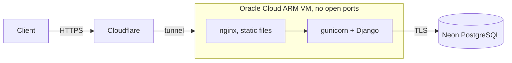

<div align="center">

[](https://github.com/hemkdev/racha-api/actions)
[](https://racha.hemk.dev)
[](LICENSE)
[](https://github.com/hemkdev/racha-api/stargazers)


</div>

# racha-api

REST API for renting sports courts **by the hour**: a daily grid of free slots, purchases of
several slots in one request, and maintenance blocks. Built for one arena, where customers book
online and **pay at the front desk**.

I built it to learn Django, DRF and PostgreSQL properly, on a real domain instead of a tutorial:
every rule that could live in the database went there, and every decision is written down. The
reasoning and most of the domain code are mine. AI wrote most of the tests, the Docker, CI and
deploy setup, and the wording of these docs.

This repo is **backend only**. Double booking is refused by the database itself, not only by the
code, including two requests at the same instant. How and why is in
[docs/database.md](docs/database.md).

## Endpoints

Every endpoint is under `/api/v1/`. Courts and their grid are public; everything else needs a JWT,
sent as `Authorization: Bearer <token>`. Lists are paginated (20 per page) and accept `?ordering=`.

The full contract is browsable at `/api/docs/` (Swagger UI) and `/api/redoc/`, both built from
the OpenAPI schema served at `/api/schema/`. The root URL redirects to the Swagger page.

Access tokens last 5 minutes and refresh tokens 1 day. There is no server-side logout: a token
stays valid until it expires. There is no sign-up either: staff create customers in the admin, and
`createsuperuser` creates a staff user.

Requests are throttled per client: 60 per minute anonymous, 300 per minute authenticated and 5 per
minute on `/token/`. Over the limit, the API answers 429.

| Method | Path | Who | Description |
|---|---|---|---|
| `POST` | `/token/` | anyone | Get an access and a refresh token |
| `POST` | `/token/refresh/` | anyone | Get a new access token |
| `GET` | `/courts/`, `/courts/{id}/` | anyone | List or read courts |
| `POST`, `PUT`, `PATCH`, `DELETE` | `/courts/`, `/courts/{id}/` | staff | Manage courts. A court with bookings cannot be deleted, only deactivated, which in turn is refused while it has future bookings |
| `GET` | `/courts/{id}/slots/?date=` | anyone | Every hour of a day with its price; taken and past hours are unavailable |
| `GET` | `/orders/`, `/orders/{id}/` | user | Customers see their own, staff see all |
| `POST` | `/orders/` | user | Buy one or more slots |
| `POST` | `/orders/{id}/confirm/` | staff | Mark a pending order as paid |
| `POST` | `/orders/{id}/cancel/` | owner, staff | Cancel a pending order |
| `GET` | `/bookings/`, `/bookings/{id}/` | user | Customers see their own, staff see all |
| `POST` | `/bookings/` | staff | Block a slot for maintenance |
| `POST` | `/bookings/{id}/cancel/` | owner, staff | Cancel one hour of a pending order, or a maintenance block, and free the slot |

### `GET /courts/`

| Param | Description |
|---|---|
| `sport` | `FUTSAL`, `SOCIETY`, `BASKETBALL`, `VOLLEYBALL`, `BEACH_VOLLEYBALL`, `FOOTVOLLEY` or `BEACH_TENNIS` |
| `tier` | `BASIC`, `PREMIUM` or `DELUXE` |
| `is_active` | `true` or `false` |
| `search` | part of the court name |

### `GET /orders/` and `GET /bookings/`

| Param | Description |
|---|---|
| `from`, `to` | period by local date (`YYYY-MM-DD`): `created_at` for orders, `starts_at` for bookings |
| `status` | orders only: `PENDING`, `PAID` or `CANCELLED` |

An invalid filter answers 400 under the parameter's name. It never returns an empty list.

### `POST /orders/`

All or nothing: if one slot is taken, no booking is created, and the response lists **every**
slot that failed and why. A customer can hold at most **4 future hours** in pending orders.

```http
POST /api/v1/orders/
Authorization: Bearer <token>
Content-Type: application/json

{
  "bookings": [
    {"court": 1, "starts_at": "2026-10-20T19:00:00-03:00"},
    {"court": 1, "starts_at": "2026-10-20T20:00:00-03:00"}
  ]
}
```

If the second hour is already taken, nothing is booked and the answer is 400, with the errors keyed
by the position of each failed slot:

```json
{"bookings": {"1": {"starts_at": ["This court is already booked for the selected time slot."]}}}
```

Staff buy on a customer's behalf by adding `"user": <customer id>`; without it the answer is 400.
Customers cannot send `user`: an order is always their own.

To find free slots first: `GET /api/v1/courts/1/slots/?date=2026-10-20`.

### Rules

- Courts open from 08:00 to 22:00. Peak hours (18:00 to 22:00) cost 1.5× the base price.
- A slot starts on the hour and lasts one hour. Buying three hours creates three bookings.
- The price paid is stored on each booking, so a later price change does not alter past orders.
- Nothing in the past can be booked or cancelled.

## Running locally

Requires Docker and [uv](https://docs.astral.sh/uv/).

```bash
cp .env.example .env          # then fill SECRET_KEY, see below
docker compose up -d          # PostgreSQL
uv sync
uv run manage.py migrate
uv run manage.py createsuperuser
uv run manage.py runserver
```

`SECRET_KEY` is empty in `.env.example` and Django refuses to start without it. Generate one with:

```bash
uv run python -c "from django.core.management.utils import get_random_secret_key as k; print(k())"
```

Tests and lint, the same checks CI runs on every pull request:

```bash
uv run pytest
uv run ruff check .
uv run ruff format --check .
uv run manage.py makemigrations --check --dry-run
```

## Deployment



Publishing a GitHub release deploys it. Actions builds the `linux/arm64` images, pushes them to
GHCR, reaches the VM over SSH through the tunnel, runs `migrate`, restarts the containers and
fails if the API answers with an error. A rollback is the same workflow run by hand with the previous
tag. It restores the code, not the schema.

## Docs

[database.md](docs/database.md) has the schema diagram, every constraint and the rules that live
in the API instead. [decisions.md](docs/decisions.md) has what was chosen, what was rejected and
why.

## Support

If this repo helped you, feel free to give it a ⭐ star. Thank you :)
