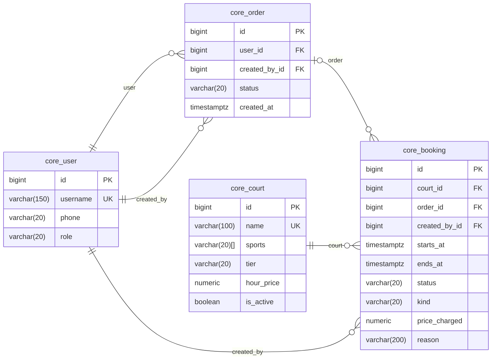

# Database schema

PostgreSQL 17, four models in the `core` app. Primary keys are `bigint` (`BigAutoField`).
Timestamps are stored in UTC and the business runs on `America/Sao_Paulo`.

Most business rules are constraints, so the database refuses invalid data whatever code writes
it. The few that cannot be are listed at the end.

## Tables

- **`core_user`**: Django's `AbstractUser` plus `phone` and `role`. API permissions follow `role`,
  not `is_staff`. There is no sign-up: staff create customers in the admin.
- **`core_court`**: `hour_price` (`numeric(6,2)`) is the base price; peak hours (18:00 to 22:00) cost 1.5×,
  computed by `Court.price_at()`. A court can be deleted only while it has no bookings; after
  that it is taken out of use with `is_active = false`.
- **`core_booking`**: one row is one hour of one court, either a customer's slot inside an order or
  a maintenance block. `price_charged` is `numeric(7,2)`, enough for a peak price. Cancelling sets `status = CANCELLED` and keeps the row.
- **`core_order`**: a purchase of one or more slots, `PENDING` until staff confirm payment.

## Design notes

**Every foreign key is `PROTECT`.** Deleting a court, user or order with bookings would erase what
was booked and paid, so the database refuses it.

**`core_order` has two foreign keys to `core_user`.** `user` owns the order, `created_by` placed
it. They differ when staff buy on a customer's behalf, and `created_by` is how the 4-hour cap knows
to skip staff purchases.

**`price_charged` is stored.** It could be recomputed from `hour_price`, but prices change: an
order paid at R$ 100 must still show R$ 100 after the court goes to R$ 120. It lives on each
booking because one order can mix normal and peak hours.

**The unique index is partial.** A cancelled booking keeps its row. A plain unique index on
`(court_id, starts_at)` would count it, and a cancelled slot could never be booked again. With
`WHERE status = 'ACTIVE'`, only one active booking per court and hour is allowed.

## Constraints

| Table | Constraint | Rule |
|---|---|---|
| `core_user` | `user_role_valid` | `role` is `STAFF` or `CUSTOMER` |
| `core_court` | `court_hour_price_positive` | `hour_price > 0` |
| `core_court` | `court_hour_price_half_steps` | `hour_price` is a multiple of 0.50 |
| `core_court` | `court_sports_valid` | every item in `sports` is a known sport |
| `core_court` | `court_sports_not_empty` | `sports` has at least one item |
| `core_court` | `court_tier_valid` | `tier` is a known tier |
| `core_booking` | `booking_status_valid` | `status` is `ACTIVE` or `CANCELLED` |
| `core_booking` | `booking_starts_before_ends` | `starts_at < ends_at` |
| `core_booking` | `booking_starts_at_full_hour` | `starts_at = DATE_TRUNC('hour', starts_at)` |
| `core_booking` | `booking_slot_lasts_one_hour` | `ends_at = starts_at + 1 hour` |
| `core_booking` | `unique_booking_per_court_time` | unique `(court_id, starts_at)` where `status = 'ACTIVE'` |
| `core_booking` | `booking_kind_fields_consistent` | customer: order, positive price, no reason; maintenance: a non-blank reason, no order, no price |
| `core_order` | `order_status_valid` | `status` is `PENDING`, `PAID` or `CANCELLED` |

## Rules enforced in the API

| Rule | Why it lives in the API |
|---|---|
| Order total | computed with `Sum` over active bookings; a stored total would drift with every cancellation |
| Booking owner | read from `booking.order.user`; a copy on the booking could disagree |
| Working hours, 08:00 to 22:00 | it is configuration, not a property of the row: as a constant, changing it is one line, not a migration that could also reject rows booked under the old hours |
| No booking in the past | `now()` keeps moving: a valid future booking would break the constraint the next day, and so would restoring a dump |
| No repeated sport on a court | a `CHECK` cannot see duplicates inside an array |
| Order owner is a `CUSTOMER` | a `CHECK` cannot read another table |
| Inactive courts cannot be booked | it depends on the court's current state, not on the booking row |
| A court with future bookings cannot be deactivated | it counts rows in another table |
| Cancelling only before the slot starts, and only while the order is `PENDING` | it depends on the clock and on the order's row |
| At most 4 pending future hours per customer | it counts other rows; it runs in the purchase transaction with the customer's row locked |
